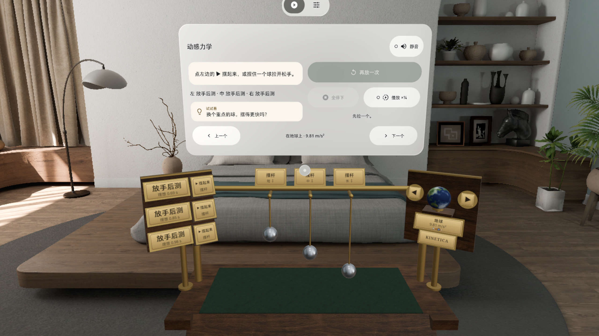

# 动感力学 Kinetica


[中文](#中文) · [English](#english)

## 中文

桌上一座胡桃木黄铜力学台：捏住小球拉开松手，看它摆、弹、撞；换挂法、换球、换星球，台座上直接读出周期。PICO OS 6 应用（Full Space 混合透视台子 + 控制窗）。

### 能做什么

- 三个挂位：摆杆、弹簧、双摆。点挂位前面的 ▶ 就自己摆起来，再点停下；也可以直接捏住小球拉开松手。
- 左边铜牌直接读出实测周期，旁边小字写理想值（地球摆杆 0.86 s，理想 0.85 s）；双摆数翻了几圈。
- 右边星球架：月球、火星、地球、木星四档重力，点 ◀ ▶ 换，周期跟着变（木星摆杆 0.54 s）。
- 点挂牌换挂法、换长短，换钢球 / 黄铜球 / 木球；左边的球能撞到中间的。
- 控制窗：再放一次、全停下、慢放 ×¼、静音；设置里叫回面前、恢复台子、退出应用。
- 抓住胡桃木底座可以挪台子，手柄摇杆左右转台子。中英双语，全离线，不联网、不需要账号。

### 截图

| | |
|---|---|
|  |  |
| 三个挂位一起摆，铜牌读出摆杆 0.87 s | 捏住左边摆杆的小球拉开（S2 捏住） |
|  |  |
| 换到木星（24.79 m/s²）：摆杆 0.54 s | 左边的球撞到中间的弹簧 |
|  |  |
| 三根不同长短的摆杆并排比 | 设置：语言、叫回面前、恢复台子、退出应用 |

截图和演示视频都是在 PICO 模拟器里用调试广播驱动拍的（走的是和真实捏合同一个监听入口），**非真实手势录像**。

### 安装

```bash
adb install -r Kinetica-v0.1.2.apk
pico-cli app launch io.embodit.kinetica
```

Release 里的 APK 是 `assembleRelease` 出的**未签名**包（给 Vibe Lab 平台托管签名用）；自己装到头显上需要先签名，或者在本仓库 `./gradlew assembleDebug` 出调试包再装。

### 已知问题（v0.1.2）

- 设置页上下空白合计约 25.3%，在 25% 阈值的误差范围内，下一版收紧。
- 换星球时静止的弹簧会因为平衡点变了自己弹一下，大约 35 s 才停；这段时间提示语说「铜牌上有周期」，但弹簧铜牌显示「放手后测」。
- 连续换星球又反复启停之后，弹簧可能留下 ±2 mm 的侧向小摆，点 ▶ 停下即可。
- 三种拖法（直接抓、手柄射线、眼手）的手感、3D 按键真手势点按、两侧翼板不转头能否看清、摇杆转台子、72 fps、声音、启动摆放，都还没在真机上确认。

## English

A walnut-and-brass physics bench on your desk. Pinch a ball, pull, let go. Watch it swing, bounce and collide, then swap the hanger, the ball or the planet and read the period right off the base. A PICO OS 6 app (Full Space mixed-reality bench + a control window).

### What you can do

- Three stations: a rod, a spring and a double pendulum. Tap ▶ in front of a station to swing it, tap again to stop; or pinch a ball, pull and let go.
- Brass plates on the left read the measured period with the ideal value underneath (rod on Earth: 0.86 s vs 0.85 s ideal); the double pendulum counts its flips.
- Planet selector on the right: Moon, Mars, Earth, Jupiter. Tap ◀ ▶ and watch the period change (rod on Jupiter: 0.54 s).
- Tap a tag to swap the hanger or its length; steel, brass or wooden balls; the left ball can hit the middle one.
- Control window: swing it again, stop all, slow-mo ×¼, mute; settings: bring it here, reset bench, quit.
- Grab the walnut base to move the bench, turn it with the controller stick. Chinese and English, fully offline, no account.

Screenshots (English UI): see the Vibe Lab listing; the Chinese ones are above. Screenshots and the demo video were captured on the PICO emulator, driven by the debug broadcast (same listener as a real pinch): **not a recording of real hand gestures**.

### Install

```bash
adb install -r Kinetica-v0.1.2.apk
pico-cli app launch io.embodit.kinetica
```

The APK on the Release is the **unsigned** `assembleRelease` build (the Vibe Lab platform signs it); to sideload, sign it first or build `./gradlew assembleDebug` from this repo.

### Known issues (v0.1.2)

- Settings page vertical padding is about 25.3% (threshold 25%, within measuring error); to be tightened.
- After a planet change the resting spring bounces once to its new equilibrium for about 35 s; the hint says the period is on the plate while the spring plate still shows "Let go".
- After many planet changes with repeated start / stop, the spring may keep a ±2 mm sideways sway; tap ▶ to stop it.
- Not yet confirmed on the headset: feel of the three drag inputs (direct grab, controller ray, eye-hand), real taps on the 3D keys, reading the side wings without turning, turning the bench with the stick, 72 fps, sound, and the start-up placement.

## Credits

Textures ambientCG (CC0), sounds Kenney (CC0), font Noto Sans (OFL). See [AGENTS.md](AGENTS.md) for the code layout and [CHANGELOG.md](CHANGELOG.md) for versions.
