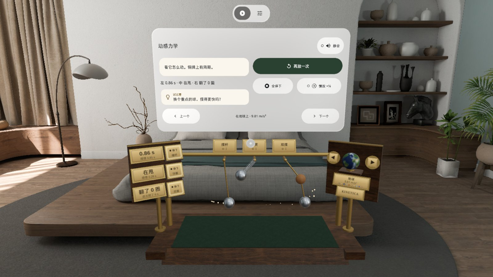
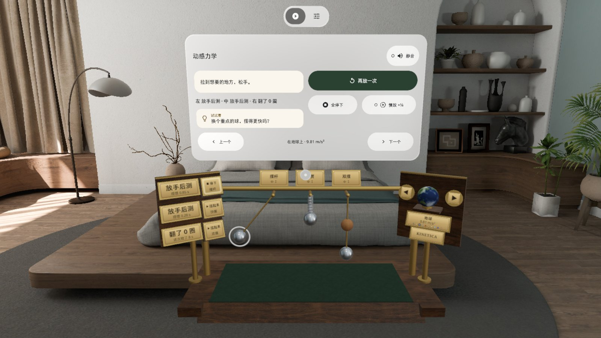
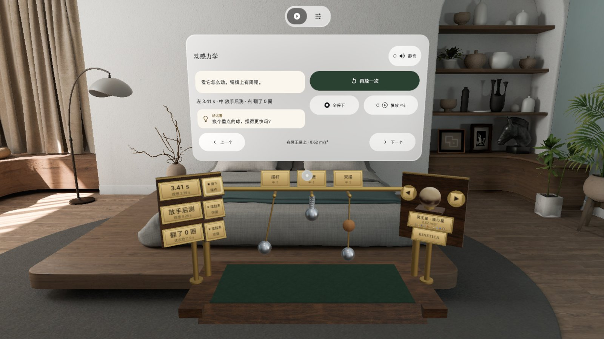
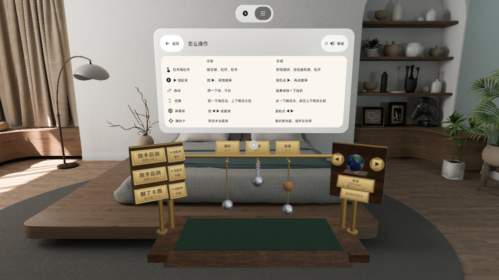

# 动感力学 Kinetica


[中文](#中文) · [English](#english)

## 中文

桌上一座胡桃木黄铜力学台：捏住小球拉开松手，看它摆、弹、撞；换挂法、换球、换星球，台座上直接读出周期。PICO OS 6 应用（Full Space 混合透视台子 + 控制窗）。

### 能做什么

- 三个挂位：摆杆、弹簧、双摆。点挂位前面的 ▶ 就自己摆起来，再点停下；也可以直接捏住小球拉开松手。
- 左边铜牌直接读出实测周期，旁边小字写理想值（地球摆杆 0.86 s，理想 0.85 s）；双摆数翻了几圈。
- 右边星球架：水星到冥王星（矮行星）加月球，十档重力按离太阳远近排，点 ◀ ▶ 循环换，周期跟着变（木星摆杆 0.54 s，冥王星 3.39 s）；土星带环，天王星带细环。
- 点挂牌换挂法、换长短，换钢球 / 黄铜球 / 木球；左边的球能撞到中间的。
- 控制窗：再放一次、全停下、慢放 ×¼、静音；设置里叫回面前、恢复台子、退出应用。
- 抓住胡桃木底座可以挪台子，手柄摇杆左右转台子。中英双语，全离线，不联网、不需要账号。

### 截图

| | |
|---|---|
|  |  |
| 三个挂位一起摆，铜牌读出摆杆 0.86 s | 捏住左边摆杆的小球拉开，控制窗提示「拉到想要的地方，松手」 |
|  |  |
| 换到土星（10.44 m/s²，带环）：摆杆 0.83 s | 换到冥王星（矮行星，0.62 m/s²）：摆杆 3.41 s |
|  |  |
| 三根不同长短的摆杆并排比：0.70 / 0.85 / 0.99 s | 设置里的「怎么操作」：手势和手柄做法并排写 |

截图和演示视频都是在 PICO 模拟器里用调试广播驱动拍的（走的是和真实捏合同一个监听入口），**非真实手势录像**，演示视频无声。

### 安装

```bash
adb install -r Kinetica-v0.1.4.apk
pico-cli app launch io.embodit.kinetica
```

Release 里的 APK 是 `assembleRelease` 出的**未签名**包（给 Vibe Lab 平台托管签名用）；自己装到头显上需要先签名，或者在本仓库 `./gradlew assembleDebug` 出调试包再装。

### 已知问题（v0.1.4）

- 真机上起拖门槛是 4 mm（研发回放用的是 2.5 cm），所以捏住以后比回放更容易拖起来；捏球时手抖不到 8 mm 仍当点一下（换球）。
- 拉开以后停住几秒再松手，球可能带着停住前的速度出发，而不是从静止摆起来（真机待确认）。
- 换星球会把三个挂位都放回新重力下的平衡位置、停住，要接着摆就再点 ▶。
- 三种拖法（直接抓、手柄射线、眼手）的手感、手柄点音量条每一档、十个星球模型、手柄射线条数、声音，都还没在真机上确认。

## English

A walnut-and-brass physics bench on your desk. Pinch a ball, pull, let go. Watch it swing, bounce and collide, then swap the hanger, the ball or the planet and read the period right off the base. A PICO OS 6 app (Full Space mixed-reality bench + a control window).

### What you can do

- Three stations: a rod, a spring and a double pendulum. Tap ▶ in front of a station to swing it, tap again to stop; or pinch a ball, pull and let go.
- Brass plates on the left read the measured period with the ideal value underneath (rod on Earth: 0.86 s vs 0.85 s ideal); the double pendulum counts its flips.
- Planet selector on the right: Mercury out to the dwarf planet Pluto, plus the Moon, ten bodies in order from the Sun. Tap ◀ ▶ to cycle and watch the period change (rod on Jupiter: 0.54 s, on Pluto: 3.39 s). Saturn has its rings, Uranus a thin ring.
- Tap a tag to swap the hanger or its length; steel, brass or wooden balls; the left ball can hit the middle one.
- Control window: swing it again, stop all, slow-mo ×¼, mute; settings: bring it here, reset bench, quit.
- Grab the walnut base to move the bench, turn it with the controller stick. Chinese and English, fully offline, no account.

Screenshots (English UI): see the Vibe Lab listing; the Chinese ones are above. Screenshots and the demo video were captured on the PICO emulator, driven by the debug broadcast (same listener as a real pinch): **not a recording of real hand gestures**; the demo video has no sound.

### Install

```bash
adb install -r Kinetica-v0.1.4.apk
pico-cli app launch io.embodit.kinetica
```

The APK on the Release is the **unsigned** `assembleRelease` build (the Vibe Lab platform signs it); to sideload, sign it first or build `./gradlew assembleDebug` from this repo.

### Known issues (v0.1.4)

- On the headset a drag starts after 4 mm (the replay tests use 2.5 cm), so a held ball picks up sooner than in the replays; a pinch that wobbles less than 8 mm is still a tap (changes the ball).
- If you pull a ball, hold still for a few seconds and then let go, it may start with the speed it had before you stopped instead of from rest (to be checked on the headset).
- A planet change puts all three hangers on their rest under the new g and stops them; tap ▶ to swing again.
- Not yet confirmed on the headset: feel of the three drag inputs (direct grab, controller ray, eye-hand), tapping every volume stop with the controller, the ten planet models, one ray per controller, and sound.

## Credits

Textures ambientCG (CC0), sounds Kenney (CC0), font Noto Sans (OFL). See [AGENTS.md](AGENTS.md) for the code layout and [CHANGELOG.md](CHANGELOG.md) for versions.
